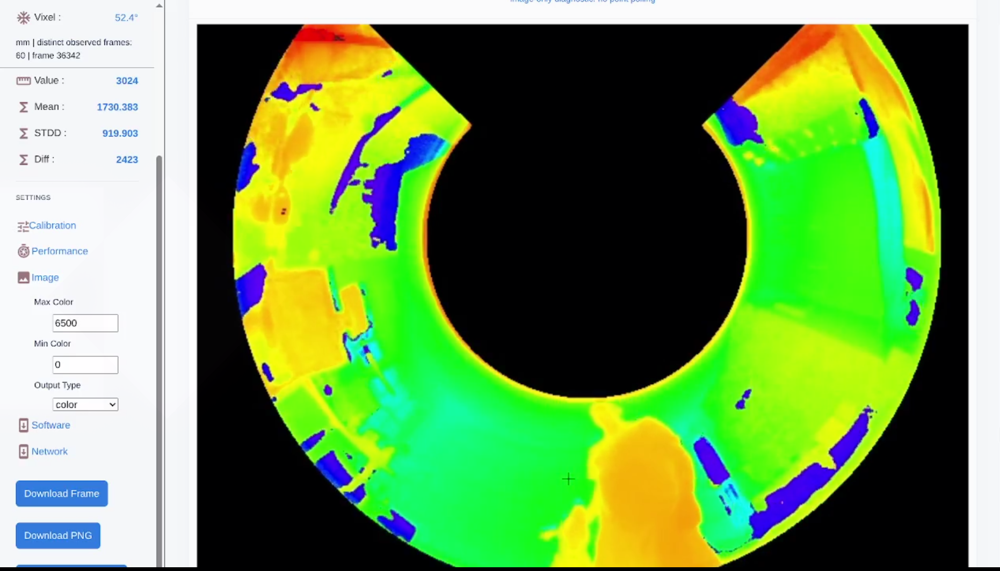
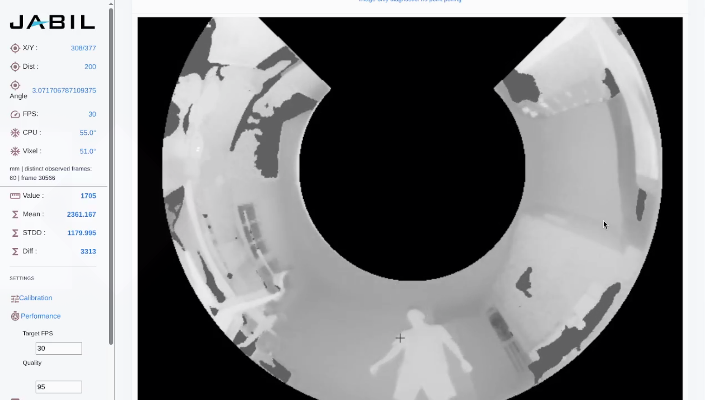
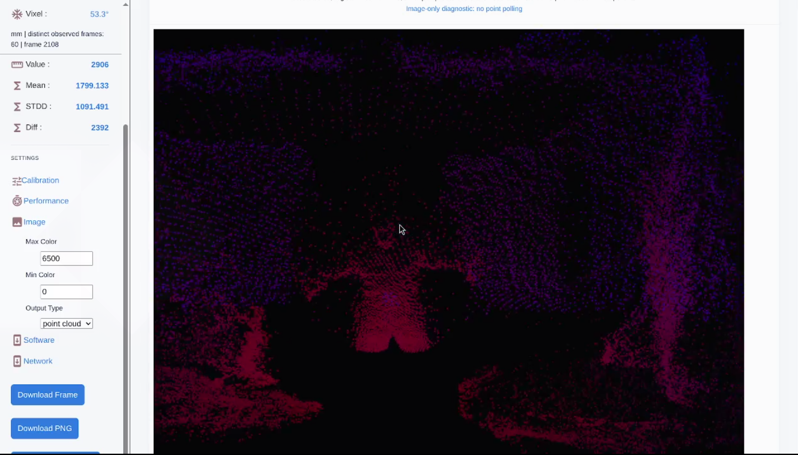

# Chiton · Embedded Vision Reference Application

**From a wide-angle depth sensor to an interactive, programmable camera system.**

A **Jabil / BitSlip6** reference application. All project-specific software, web
applications, plugins, kernel drivers, and firmware by **Cory Marsh**.

[](https://github.com/bitslip6/chiton/actions/workflows/ubuntu1804_gcc_7.5.0_intel.yml)

[See the application](#see-the-application) · [Engineering highlights](#engineering-highlights) · [Try it locally](#try-it-without-a-camera) · [Project inquiries](#project-inquiries)

Chiton is the camera evaluation application for the **Jabil Chiton 8-vixel,
940 nm Time-of-Flight camera**: **270° coverage, VGA (640 × 480), and 30 fps**.
It brings sensor control, on-device processing, live visualization, measurements,
and data export together in a browser-based interface served directly by the
camera.

This repository is a reference for the work involved in turning specialized
hardware into a usable development platform: embedded Linux and C++, camera SDK
integration, image processing, network protocols, browser interfaces, and the
tooling needed to test and deploy them.

[](images/chiton-color-dog.png)

*Color-mapped depth view. Colors represent depth, not the visible-light colors of
the scene. Select any screenshot to view it at full size.*

## The project at a glance

Originally developed in **2019–2021**, the camera platform combines an **i.MX8
system-on-module**, a **Sony CMOS image sensor**, and an **Analog Devices (ADI)
Time-of-Flight ASIC**. ToF imaging measures distance using emitted light and its
return, producing depth data as well as infrared intensity images.

| | Camera platform |
| --- | --- |
| Sensing | 8-vixel, 940 nm Time-of-Flight; depth and infrared intensity |
| Field of view | 270 degrees |
| Acquisition | VGA, 640 × 480 pixels at 30 frames per second |
| Compute | i.MX8 SOM running embedded Linux |
| Connectivity | Gigabit Ethernet and/or 2.4 GHz wireless |
| Extensibility | Customer C++ processing code runs on the camera through a native plugin |
| Client access | Browser UI, HTTP data exports, and persistent JPEG WebSocket streaming |

The platform supports hardware encode/decode and 30-fps data export in a variety
of formats. Delivered frame rate depends on processing, format, codec path,
and network conditions—not every export or wireless connection sustains the
sensor rate. The current application JPEG path uses **libjpeg**; desktop tests
do not exercise hardware codecs.

## From sensor data to an evaluation workflow

A camera SDK provides frames. An evaluation application must also make those
frames useful to people building a product around the sensor.

Chiton connects that workflow:

1. **Explore the scene.** Switch between depth and IR, adjust visualization, and
   inspect the camera's wide-angle view from a browser.
2. **Understand the measurements.** Select pixels or regions and inspect values,
   statistics, units, and the frame's processing state.
3. **Develop on the device.** Add customer processing through `api.so`, keeping
   frame processing close to the sensor.
4. **Integrate with other tools.** Export processed 16-bit images, JPEGs, binary
   point clouds, and OBJ vertices through documented interfaces.
5. **Iterate without tying up hardware.** Use file-backed camera simulation and
   automated tests on a Linux development machine.

## See the application

| Grayscale view | 3D point-cloud view |
| --- | --- |
| [](images/greyscale.png) | [](images/chiton-point-cloud.png) |
| Inspect the scene and selected-pixel values. | Explore the scene as spatial points and export its geometry. |

The application also supports an **unwrapped planar view**, presenting the
curved camera image as a horizontal strip. See the
[planar-view diagnostic capture](images/chiton-unwrap-dog.png).

These are application screenshots, not design mockups or benchmark reports.
The diagnostic capture includes development telemetry; displayed counters do
not substitute for a controlled performance measurement.

## Engineering highlights

| Area | What this reference demonstrates |
| --- | --- |
| **Embedded camera integration** | ADI SDK integration, capture lifecycle management, device-global settings, and framebuffer/headless operation on Linux |
| **Image processing and geometry** | Calibration, smoothing, grayscale/color rendering, planar remapping, and point-cloud generation |
| **On-device extensibility** | A native C++ plugin interface for customer frame processing without a separate processing host |
| **Networked visualization** | Camera-hosted browser UI, persistent JPEG streaming, bounded per-viewer buffering, and snapshot fallback |
| **Data integrity** | Snapshot-bound metadata, explicit units and frame IDs, isolated measurement histories, and checked calibration storage |
| **Developer experience** | A file-backed simulator, portable ARM/x86 SIMD support, CMake/Make builds, and documented data contracts |
| **Validation and deployment** | Sanitizer and browser CI gates, retained failure logs, and versioned AArch64 bundles with an operator-controlled rollback process |

### How the pieces fit together

```text
Jabil ToF camera + ADI SDK          File-backed simulator
             \                         /
              +---- Capture pipeline --+
                            |
                  On-device processing
             calibration / customer plugin / rendering
                            |
              +-------------+--------------+
              |                            |
     Processed data + metadata      JPEG encoding + publication
              |                            |
     HTTP measurements/exports      WebSocket / HTTP preview
              |                            |
              +------ Browser / client ----+
```

The browser does not need to own the camera SDK. Processing stays on the device,
while clients consume published representations. Raw data and JPEGs retain the
metadata of their actual source frame, even when encoding finishes later.
Slow JPEG viewers can skip intermediate frames instead of accumulating an
unbounded backlog.

For implementation details, see [image streaming](docs/image-streaming.md),
[measurement semantics](docs/measurements.md), and
[HTTP contracts](docs/http-contracts.md).

## Try it without a camera

The application builds on **Linux with a C++17 compiler**. This Ubuntu/Debian
example runs the real application against simulated depth and IR inputs—no
camera SDK installation or physical camera is needed.

### 1. Get the source and dependencies

```sh
git clone https://github.com/bitslip6/chiton.git
cd chiton
git submodule update --init -- FunctionalPlus

sudo apt-get update
sudo apt-get install -y build-essential cmake pkg-config python3 \
  libpng-dev libjpeg-dev zlib1g-dev libi2c-dev libsimde-dev
```

Initialize only the named build dependency; unrelated legacy gitlinks are not
needed. CMake 3.10 or newer is required. If SIMDe is not packaged for your system,
use a [SIMDe checkout](https://github.com/simd-everywhere/simde) and add
`-DSIMDE_INCLUDE_DIR=/path/to/simde` to the configuration command.

### 2. Build and run

```sh
cmake -S . -B _build/desktop \
  -DUSE_ADITOF_STUB=ON \
  -DUSE_SDL2=OFF \
  -DCHITON_DEFAULT_DISPLAY=headless
cmake --build _build/desktop -j2

python3 tools/generate_stub_images.py --pattern gradient --output-dir /tmp/chiton-images
ADITOF_STUB_IR=/tmp/chiton-images/aditof-ir.bin \
ADITOF_STUB_DEPTH=/tmp/chiton-images/aditof-depth.bin \
  ./_build/desktop/chiton --display headless
```

Open **`http://localhost/`** or **`http://localhost:8080/`**, using the port printed
in the startup log. The app tries port 80, then 8080; at least one must be
available and permitted. Stop it with **Ctrl+C**.

The generated gradient is a repeatable test input, not the scene shown in the
screenshots. The generator refuses to overwrite existing images unless you
add `--force`.

<details>
<summary><strong>Simulator inputs, desktop preview, and Make builds</strong></summary>

Each simulator input contains exactly 640 × 480 little-endian unsigned 16-bit
samples (614,400 bytes), row-major with no header. Camera samples use the 12-bit
range 0–4095. The same images are returned repeatedly, so this is not a sensor
performance benchmark. Missing explicitly selected files or incorrect sizes
cause initialization to fail.

Without explicit paths, the simulator uses `aditof-ir.bin` and `aditof-depth.bin`
in the working directory, creating missing defaults with every pixel set to 320.

For a local preview window, install `libsdl2-dev` and build separately:

```sh
cmake -S . -B _build/desktop-sdl -DUSE_ADITOF_STUB=ON -DUSE_SDL2=ON
cmake --build _build/desktop-sdl -j2
./_build/desktop-sdl/chiton --display desktop
```

Display choices are `auto`, `desktop`, `framebuffer`, and `headless`. Headless
mode keeps capture and network access active without a local screen.
Legacy LVGL is not required.

Alternatively, use Make:

```sh
make USE_ADITOF_STUB=1 USE_SDL2=0
./bin/chiton --display headless
```

Make outputs `bin/chiton` and isolates build variants under `_build/`.
Use `make print` to inspect configuration. Compiler and architecture overrides
must be explicit; native compilers are the default.

</details>

## Connect a client or add your own processing

On a running camera, open `http://<camera-address>/`, adding `:8080` if required
by the startup log. The device address and wireless provisioning depend on its
installed image and configuration.

| Output | Route | Format |
| --- | --- | --- |
| Frame metadata | `/frame/camera` | JSON mode, type, dimensions, frame ID, age, and processing state |
| Processed depth or IR | `/raw/camera` | 640 × 480 unsigned 16-bit samples; response headers identify units and byte order |
| Preview image | `/image/camera` | JPEG, with dimensions determined by the selected mode |
| Binary point cloud | `/pointcloud/camera` | Signed 16-bit X/Y/Z/distance records |
| OBJ point cloud | `/pointcloud_obj/camera` | ASCII vertices; coordinates divided by 6000 |

**Settings are device-global.** Select cloud mode (4) before point-cloud exports;
reads do not change the mode. “Raw” is a historical endpoint name: samples may
include calibration, smoothing, and plugin processing. Consult the
[data contracts](docs/http-contracts.md) rather than assuming untouched sensor
values or millimeter units.

To wait for a newer snapshot, use `?after=<frame_id>&timeout_ms=1000` on a frame
endpoint. Ordinary reads may return 503 during a transition; newer-frame waits
return 504 on expiry, and incompatible formats return 409. Wait on the JPEG
endpoint itself when you need an encoded image—raw metadata can publish first.
Timestamps describe host receipt, not physical exposure.

### Customer processing plugins

[`api/api.cpp`](api/api.cpp) and [`api/api.h`](api/api.h) provide the example
`process_standard_frame` callback and optional `set_runlines` mapping callback.
Build the example from the repository root with **`make api`**. For the camera,
compile against its architecture and ABI and include `api.so` in the release's
resource location. Desktop binaries are not interchangeable with i.MX8 binaries.

Plugins run as trusted native code inside the application, not in a sandbox.
Their execution time contributes to the frame-processing budget. Review the
[plugin compatibility contract](docs/measurements.md), including private-copy
ownership and the legacy final-element counter, before integrating your code.

## Build and deploy to the camera

Hardware builds require the **real ADI SDK**, an ARM/AArch64 toolchain, and
libraries compatible with the device's Linux image. Select
`USE_ADITOF_STUB=OFF` in CMake or `USE_ADITOF_STUB=0` in Make; those options do
not install a toolchain or SDK for you.

- [Cross-build and target-library compatibility](docs/aarch64-cross-build.md)
- [Versioned application bundles, configuration, and rollback](docs/deployment-bundle.md)
- [Release process and hardware qualification checklist](docs/release-gates.md)

Deploy assets and private libraries with the executable. Preserve device
configuration/calibration and a known-good release, and stop the existing
camera owner before starting another. Do not run two camera-owning processes.

**Network boundary:** use a trusted network or an authenticated TLS reverse
proxy. This evaluation app is not an authenticated public Internet service;
legacy device-management routes can change device state.

## Quality and validation

The live badge at the top links to the **Web release gates** workflow. GitHub
Actions runs on pushes and pull requests, with separate checks for:

- **Normal and sanitizer builds:** AddressSanitizer, UndefinedBehaviorSanitizer,
  and ThreadSanitizer headless simulator variants on Ubuntu 22.04.
- **Application contracts:** native tests and simulator HTTP checks for frames,
  measurements, exports, settings, and lifecycle behavior.
- **Browser behavior:** Chromium recovery/download checks for both shipped UI
  copies, alongside deterministic UI tests.

Run the same desktop gates locally with build dependencies, Node.js, and Chromium:

```sh
python3 tests/release_gate.py --all --output /tmp/chiton-release-checks --jobs 2
```

Use a **new output directory**. Failed checks stop the gate and logs are retained.
See [focused validation commands](tests/SAFETY.md) and the
[release-gate scope](docs/release-gates.md).

**Validation scope:** desktop CI is software evidence, not optical, illumination
safety, hardware codec, or sustained network-throughput qualification. Those
require on-target testing. The legacy Yocto workflows are manual checkout-only
placeholders, not cross-build gates. Ordinary HTTP requests remain sequential;
the persistent JPEG stream uses its own bounded reactor. Remaining engineering
work is tracked in the [web-server review](docs/web-server-review.md).

## Explore the repository

| Location | Contents |
| --- | --- |
| `src/`, `include/` | Camera integration, processing, display, and network services |
| `api/` | Customer frame-processing plugin example |
| `release/` | Browser assets and application resources |
| `images/` | Application screenshots |
| `tests/` | Native, HTTP, browser, and release-gate checks |
| `tools/` | Fixture generation, packaging, and development utilities |
| `docs/` | Architecture details, data contracts, deployment, and engineering notes |
| `linux/`, `devops/`, `deprecated/` | Hardware support and legacy platform material |

For display work, see [TFT refresh qualification](docs/display-refresh-benchmark.md)
and [SPI driver diagnostics](docs/spi-display-diagnostics.md).

## Project inquiries

Building a camera, sensor, or embedded product that needs more than a driver?
This reference spans the path from device integration and on-device processing
to a usable client interface, test tooling, and deployment.

For **Jabil / BitSlip6** project inquiries, contact **Cory Marsh** at
**[cory@bitslip6.com](mailto:cory@bitslip6.com)**.

## Rights and attribution

**Business:** Jabil / BitSlip6. **Software author:** Cory Marsh, responsible for
all project-specific software, web applications, plugins, kernel drivers, and
firmware. Third-party components retain their own authorship and license terms.

The repository's [license notice](LICENSE) states **Copyright 2020 Jabil. All
rights reserved.** Public visibility is not an open-source license; consult that
notice for rights and contact information.
